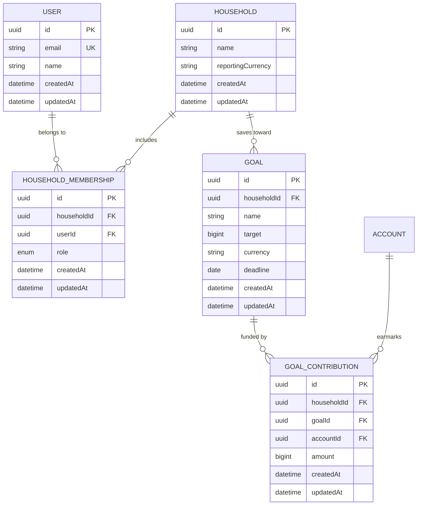

# Database schema

This document visualizes the PostgreSQL schema managed by Prisma in `apps/api/prisma/schema.prisma`.

## Notes

- A `User` can belong to many households through `HouseholdMembership`.
- A `Household` can include many users through `HouseholdMembership`.
- `HouseholdMembership.role` is an enum with values `OWNER` and `MEMBER`.
- A partial unique index on `HouseholdMembership(householdId) WHERE role = 'OWNER'` enforces **at most one OWNER per household**. The application layer ensures a household is created with exactly one OWNER.
- `User.email` is unique and normalized to lowercase by the domain factory.
- A `Goal` earmarks money from Accounts through `GoalContribution` without creating Transactions (issue #28). The `target` and `amount` are minor units in the `Goal` Currency, which must match the funding `Account` Currency; the saved amount is derived from Contributions. Deleting a `Goal` or `Account` cascades its Contributions.
- The `ACCOUNT` entity is abbreviated in this diagram (only its role in `GoalContribution`); see `schema.prisma` for the full model.
